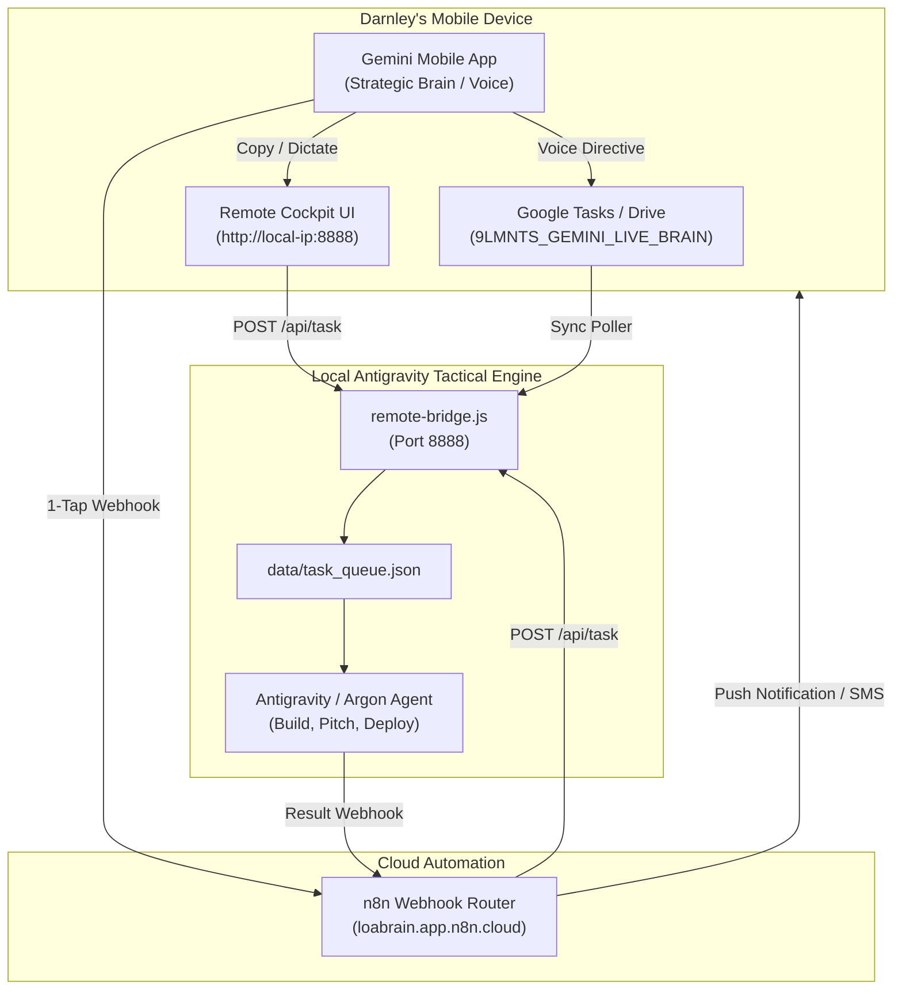

# 9LMNTS Studio — Gemini Mobile Brain Sync Protocol

This document outlines the official rails connecting the **Gemini Mobile App** (Android / iOS / Gemini Live / Google Workspace) to **Google Antigravity** (Local Tactical Execution Engine & Argon Swarm).

---

## The 3 Sync Protocols



---

### Protocol 1: The Remote Cockpit Bridge (`remote-bridge.js`)
**Best for:** Direct real-time control from your phone while at your desk or walking around Ottawa on the same Wi-Fi.

1. **Launch the Bridge Server:**
   ```bash
   node remote-bridge.js
   ```
2. **Access from Smartphone Browser:**
   Open: `http://<YOUR_LOCAL_PC_IP>:8888/remote-cockpit.html`
3. **Usage:**
   - Speak your directive into the Gemini Mobile App.
   - Tap "Copy" or speak into the Cockpit input.
   - Tap **"Transmit to Antigravity Engine"**.
   - Immediate actions like `snapshot` or `pitch <Client Name>` execute instantly and report back `✓ COMPLETED`.

---

### Protocol 2: The n8n Webhook Mobile Rail (`https://loabrain.app.n8n.cloud`)
**Best for:** 100% remote control from anywhere in the world when away from your local Wi-Fi.

1. In the Gemini App or Google Assistant, send a webhook payload to:
   ```
   POST https://loabrain.app.n8n.cloud/webhook/scraper-intake
   ```
   **Payload:**
   ```json
   {
     "clientName": "Margo Caribbean Restaurant",
     "vertical": "Chef OS",
     "phone": "613-555-0199",
     "directive": "Generate high-converting catering preview and 50% deposit rail"
   }
   ```
2. n8n executes the logic in [`automation/9lmnts-automation.json`](file:///c:/Users/Darnl/OneDrive/Documents/Desktop/9LMNTS-Site/automation/9lmnts-automation.json).
3. When the build is verified, n8n sends a 1-tap WhatsApp or push notification to your phone for final operator approval.

---

### Protocol 3: Google Workspace / Google Tasks Sync
**Best for:** Hands-free voice task capture in Gemini App using natural language.

1. **In Gemini Mobile App:**
   - Say: *"Gemini, add a task to Google Tasks: Build Handyman OS dispatch demo for Andre at 203 Rochester St."*
2. **Syncing to Antigravity:**
   - The task appears in your Google Tasks / Google Keep list.
   - Antigravity queries or receives task updates via the local bridge or n8n Google Tasks integration node, pulling the task directly into the active build cycle.
